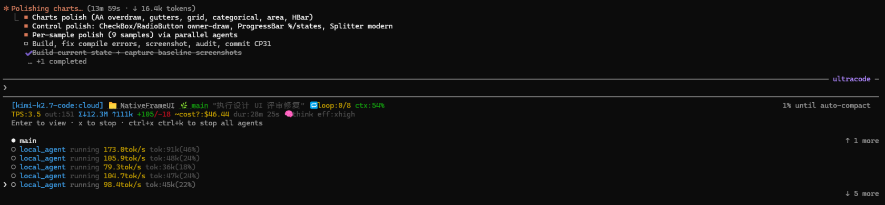

# cc-statusline

A custom status line for [Claude Code](https://claude.ai/code): model, output TPS, token/cost totals, git branch, context usage, prompt-cache health and rate limits — plus one row per subagent. Single-file Node.js scripts, zero dependencies (built-ins only), Node ≥ 16 or Bun.



## What it shows

Main session — two lines; every segment appears only when the data exists:

```
[Sonnet 5] 📁 my-project 🌿 main PR#123👀 🌳wt:my-wt ctx:42%/200k
TPS:38.2 out:1.2k cache:15k pc:87%(5m) Σ↓120k ↑8.4k +120/-15 ~cost:$0.31 dur:2m 14s 5h:24% (2h06m) 7d:81% sp:45% ⚡fast 🧠think eff:high
```

| Segment | Meaning |
|---|---|
| `[model]` `📁` `🌿` `PR#` | Model, cwd (clickable `file://` link), branch (clickable link to its GitHub / GitLab / Bitbucket page), PR/MR number (clickable link to the PR page) |
| `PR#123👀` / `MR#` | PR number + review state; GitLab merge requests render `MR#` |
| `🌳wt:` / `🤖` | Worktree name (worktree sessions and plain linked worktrees; clickable in worktree sessions) / agent name (`--agent` sessions) |
| `ctx:42%/200k` | Context usage against the actual window size (green → yellow → red) |
| `TPS:38.2` | Output tokens/sec of the last response; `(Xm ago)` once it's over 2 min stale |
| `out:` `cache:` | Last response's output / cache-read tokens |
| `pc:87%(5m)` `⚠tools` | Prompt-cache hit ratio + TTL (`(cold)` while rebuilding) — every miss re-bills cache-write on the whole prefix; `⚠` names the diagnosed cause of the last miss (`tools` / `sysprompt` / `ttl5m` / `server`) |
| `Σ↓ ↑` | Session-wide input/output token totals |
| `+120/-15` | Lines added / removed |
| `~cost:` | Self-computed cost (see below); `~cost?:` marks the untrusted client-estimate fallback |
| `dur:` | Session duration |
| `5h:` `7d:` `sp:` | Rate-limit / spend-limit usage, with a compact time-to-reset; `sp:` shows `$used/$limit` dollars behind a gateway when available |
| `⚡fast` `🧠think` `eff:` `VIM:` `style:` | Mode flags; the trailing `v2.x` is the Claude Code version, `ccsl2.x` the status line's own version (a stale install becomes visible) |

Subagent rows — one line per task, real stats from the agent's own transcript when available (`TPS`), payload-derived fallback otherwise (`tok/s`):

```
local_agent  running  Verifying soak.sh binary configuration  67.5TPS  tok:198k(20%)  out:8.7k  1h7m  ~$1.23
Explore      running  166.7tok/s  tok:50k(25%)  5m00s  ~$0.01  eff:high
```

## Install

```bash
npm install -g @tangjianfang/claudecode-statusline
```

Done — the postinstall copies `statusline.js` to `~/.claude/`, registers it as both `statusLine` and `subagentStatusLine`, and seeds `~/.claude/pricing.json`. Restart Claude Code. Also published under the shorter name `@tangjianfang/cc-statusline`.

Other package managers and newer npm (all tested; the only difference is whether the wiring postinstall is allowed to run):

| Manager | Command | Wiring |
|---|---|---|
| npm ≤ 11 | `npm install -g @tangjianfang/claudecode-statusline` | automatic |
| npm 12+ | add `--allow-scripts=@tangjianfang/claudecode-statusline` to the install (or `npm config set allow-scripts=@tangjianfang/claudecode-statusline --location=user` once, for all global installs) — npm v12 blocks install scripts by default | after `--allow-scripts` |
| Yarn Classic (v1) | `yarn global add @tangjianfang/claudecode-statusline` | automatic |
| Bun | `bun add -g @tangjianfang/claudecode-statusline` then `bun pm -g trust @tangjianfang/claudecode-statusline` | after `trust` |
| pnpm (v10+) | `pnpm add -g @tangjianfang/claudecode-statusline` then `pnpm approve-builds -g` | after approval |
| Yarn Berry (v2+) | add as a project dependency, then run `cc-statusline --install` once | manual (Berry removed `global add`) |

Under Bun the registered interpreter is the real Bun binary, so Node doesn't need to be installed. Manual wiring works everywhere: `cc-statusline --install` (or `git clone` + `./install.sh`); check what's wired with `cc-statusline status`.

> **Installed with Bun, pnpm or npm 12+ and the status line doesn't show?** Nothing is broken — those managers block package install scripts by default, so the wiring postinstall never ran (Bun prints one easy-to-miss line, `Blocked 2 postinstalls`). Run `cc-statusline --install` to wire it manually, or let the scripts run as shown in the table above.

> **Upgrading from v1.x?** The `loopctl` auto-continue loop was removed — Claude Code has native `/goal` now. The postinstall deregisters its Stop hook and deletes the old files automatically.

## Cost estimation

Claude Code's `total_cost_usd` is priced at Anthropic's rates — wrong when you route to a third-party model via `ANTHROPIC_BASE_URL` (MiniMax, GLM, Kimi, …). So the script self-computes cost from the transcript's token counts × a plain, editable pricing table:

```
cost = freshInput/1M × in + output/1M × out + cacheRead/1M × cacheRead + cacheCreate/1M × cacheWrite
```

`pricing.json` ships with the repo and is seeded to `~/.claude/pricing.json` on install (never overwrites your copy). It covers the canonical chat models of Anthropic, OpenAI, Gemini, MiniMax, DeepSeek, Llama, Mistral, Grok, Cohere, Qwen, Z.ai/GLM and Moonshot/Kimi, keyed by model name — exact match first, then longest substring (`glm-5.3[1m]` matches `glm-5.3`). No match → falls back to the client estimate, shown as `~cost?:`.

Refresh rates on demand (deliberately no auto-update — rewriting rate data in the background is not this tool's job):

```bash
pricing-updater                                  # merge fresh rates into ~/.claude/pricing.json
pricing-updater --list minimax                   # inspect matching keys + rates, write nothing
pricing-updater --out pricing.json --overwrite   # maintainer: refresh the repo's shipped copy
```

## How it works

Claude Code pipes a JSON payload on stdin. Per-message token/timing data isn't in it, so the script re-parses the JSONL transcript at `transcript_path`, pairing each assistant message's `usage.output_tokens` with the preceding user-message timestamp to derive TPS, and accumulating session-wide totals (sidechain entries feed the Σ totals but not the main-line figures). Subagent stats come from `<project dir>/<session id>/subagents/agent-<task id>.jsonl`, parsed the same way. To see what your build actually sends: `touch ~/.claude/statusline-debug`, reproduce, then read `~/.claude/statusline-payloads.log`.

## Companion mod (quick buttons + usage pane)

A Claude Code **mod** shipped alongside the status line. It runs inside Claude Code, so it can do things a status-line subprocess can't: hotkeyed buttons and per-request usage stats, straight from the engine.

### Quick start

`cc-statusline --install` offers to copy it to `~/.claude/skills/cc-statusline-mod/` (loaded at every startup); preview one session with `claude --plugin-dir /path/to/node_modules/@tangjianfang/claudecode-statusline/mod`. Then:

1. Press `m` (or click `＊`, the accent-colored star at the left of the band) — the launcher opens
2. Click a button — or press its hotkey once the pane has the keys. Opened from the band it doesn't have them yet (the band holds the keys and focus is only a request); click the pane, or run `/ccsl`, which places it with the keyboard at any width. Commands and links run at once; prompts and mode switches **fill the composer** — review, then Enter. Esc closes

What you see — every function on screen at once, grouped into colored cards:

```
╭─ ⚡ 快捷切换 ────────────────╮
│ f: 快速模式    p: 权限设置   │
│ o: 模型选择    k: 压缩上下文 │
│ u: 用量面板                 │
╰─────────────────────────────╯
╭─ ✏ 提示词 ──────────────────╮
│ n: 继续任务    t: 测试并修复 │
│ r: 审查改动    l: 修复告警   │
│ …                           │
╰─────────────────────────────╯
╭─ 🔗 链接 ───────────────────╮
│ a: 仓库  github.com/…       │
╰─────────────────────────────╯
╭─ $ 命令 ────────────────────╮
│ g: git状态  git status -sb  │
│ ↳ git状态: exit 0           │
╰─────────────────────────────╯
```

On a terminal too narrow to seat the pane, the same view expands inline in the band instead — same buttons, any width.

### What's on it

| Section | Hotkeys | What they do |
|---|---|---|
| ⚡ 快捷切换 | `f` `p` `o` `k` `u` | mode switches, filled for Enter: fast mode, permissions dialog, model picker, context compact, usage pane |
| ✏ 提示词 | `n` `t` `r` `l` `w` `d` `s` `b` `q` `x` | 10 curated engineering prompts, filled for review then Enter (继续任务 / 测试并修复 / 审查改动 / 修复告警 / 重构文件 / 补文档 / 写提交 / 定位bug / 性能分析 / 解释架构) |
| 🔗 链接 | `a` `i` | bookmarks — alias + dim address, click opens the browser |
| $ 命令 | `g` `y` `j` `v` | host commands with their argv shown; results appear inline, green on exit 0, red on failure |

A mod can't set permission modes (API limitation) — `p` opens Claude Code's permissions dialog, which is the shortest path.

`/ccsl-usage` opens the usage pane: per-request output sparkline, cumulative totals, **cost** (`$X 会话 · $Y 累计` — computed from the same `~/.claude/pricing.json` the status line uses; run `pricing-updater` once to generate it) and the context estimate `ctx n/200k (%)`. The totals window is a rolling "last 240 requests" across sessions and includes subagent steps; two concurrent sessions share one history (last writer wins). A toast warns once when the context passes 80% and 90% of the window (set `contextWindow` in `~/.claude/ccsl-buttons.json`; re-arms after a `/compact`). While a turn runs, a dim `· 运行中` marks the band.

`/ccsl` toggles the launcher straight from the composer — unlike the band button it always takes the keyboard (hotkeys work at once), it places at any width, and it's the entry point while the mod is hidden below `hideBelow`. Optional key bindings:

```json
{
  "bindings": [
    { "context": "Chat", "bindings": {
      "meta+u": "command:ccsl-usage",
      "meta+e": "command:ccsl"
    } }
  ]
}
```

### Customize

Buttons live in `~/.claude/ccsl-buttons.json` (auto-created with the template above). One button = one action — five types plus two grouping fields:

```json
{
  "toggle": { "label": "✳", "hotkey": "m" },
  "buttons": [
    { "label": "快速模式", "hotkey": "f", "slash": "fast" },
    { "label": "预检", "hotkey": "c", "prompt": "Check CI status and summarize failures." },
    { "label": "仓库", "hotkey": "o", "url": "https://github.com/me/repo" },
    { "label": "跑构建", "hotkey": "b", "run": ["npm", "run", "build"] },
    { "label": "面板", "hotkey": "g", "pane": "ccsl-usage" },
    { "label": "发布", "hotkey": "d", "group": "发布", "run": ["npm", "run", "deploy"] }
  ]
}
```

- `slash` fills `/<command>` (fast, permissions, model, compact…); `prompt` fills the text — Enter sends it, nothing runs unconfirmed; `url`, `run`, `pane` open a bookmark, a host command, or a mod pane at once
- `group` gives a button its own section; `toggle` restyles the band button (label/hotkey); `contextWindow` sets the token window for the budget alerts (default 200000); `hideBelow` hides the mod entirely below that many columns (default 100 — small terminals are never fought over, `/ccsl` still works); `band: false` removes the band row for command-only use
- hotkeys: one digit or lowercase letter, live while the launcher holds focus — duplicates are dropped at load with a note

Edit the file, then `/ccsl-buttons` reloads it (skipped entries and duplicate hotkeys are reported; a broken file keeps the last good config and says why). A file that still byte-matches an old factory template upgrades itself automatically on load — your edits are never overwritten. Note the file is a one-press host-command entry point: treat write access to it accordingly.

Remove the mod by deleting `~/.claude/skills/cc-statusline-mod/`. It never runs when `disableAllHooks` is true (that flag also disables custom status lines).

## Limitations

- **TPS describes the last response, not real-time decode** — the window includes network round-trips and time-to-first-token, and the line only re-runs when a new message completes. Add `"refreshInterval": 2` to the statusLine config for more frequent refresh.
- **`~cost:` is an estimate** — as accurate as your `pricing.json` rates.
- **Subagent stats depend on the agent transcript** — without it, rows fall back to the payload's sparsely-populated `tokenCount`/`tokenSamples`; absent fields are omitted rather than shown as zeros.
- **Narrow terminals** — when a line exceeds `COLUMNS`, the least-essential segments drop off (version markers → mode flags → …); model/dir and TPS/cost always stay. Subagent rows shrink their activity label instead of wrapping.
- **`pc:` / `5h:` / `7d:` / `sp:` need gateway data** — they appear only after the first API response, and may never appear on third-party `ANTHROPIC_BASE_URL` gateways.
- **Branch links cover GitHub / GitLab / Bitbucket** — self-hosted Git renders plain text.
- **The companion mod rides on a young API** — every call is feature-checked and failure-tolerant, but a Claude Code update can still change what it draws. The status line never depends on it.

## Releasing a new version (maintainer)

Pushes to `main` auto-publish via CI — but only when the version in `package.json` differs from npm, so docs-only pushes stay silent. Flow: `npm version patch` → update `CHANGELOG.md` → commit & push. CI publishes both package names, pushes the `vX.Y.Z` tag, and creates the GitHub Release.

CI authentication: the classic route is a granular npm token with publish scope on both packages stored as the `NPM_TOKEN` secret — note npm is deprecating 2FA-bypass tokens (they lose account/package management now and direct publish around Jan 2027, per npm's [security changelog](https://github.blog/changelog/2026-07-08-npm-install-time-security-and-gat-bypass2fa-deprecation/)), so plan to migrate the workflow to npm **trusted publishing** (OIDC, tokenless) before then.
